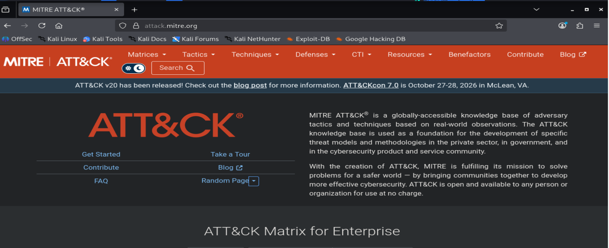
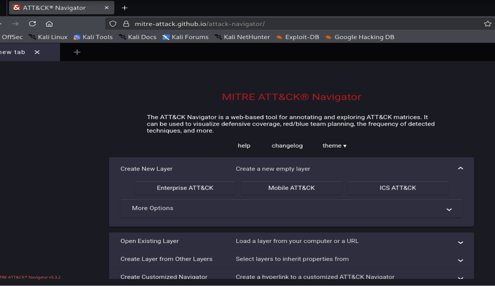
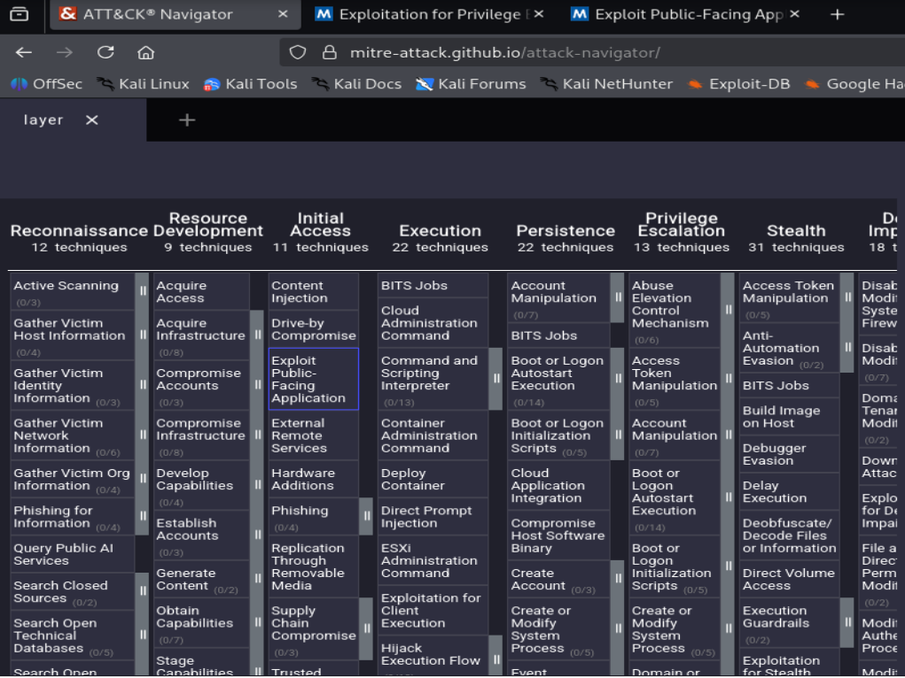
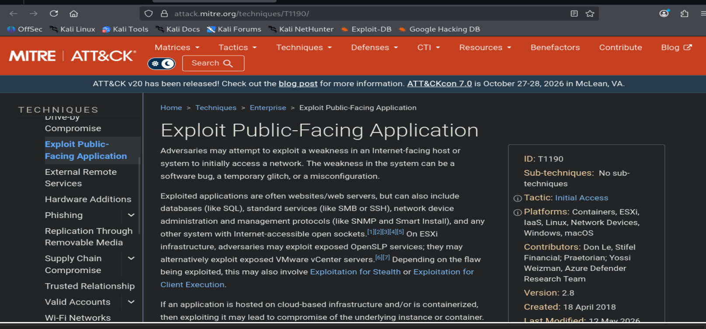

# Experiment 8: MITRE ATT&CK Mapping

## Aim

To document an authorized security-lab exercise and review the MITRE ATT&CK Enterprise framework as a way to describe observed behavior.

## Requirements and scope

- Kali Linux with Metasploit Framework
- An isolated lab host on a private lab network
- A web browser with access to MITRE ATT&CK and ATT&CK Navigator

## Theory

MITRE ATT&CK is a knowledge base for describing adversary behavior. A **tactic** represents an objective, while a **technique** describes a method that may be used to achieve it. The Enterprise matrix groups techniques under tactics, and ATT&CK Navigator provides a visual interface for exploring and selecting them.

Two technique descriptions were reviewed during this experiment:

- [T1190: Exploit Public-Facing Application](https://attack.mitre.org/techniques/T1190/) is an Initial Access technique describing exploitation of a weakness in an Internet-facing host or system.
- [T1068: Exploitation for Privilege Escalation](https://attack.mitre.org/techniques/T1068/) is a Privilege Escalation technique describing exploitation of a software vulnerability to gain higher privileges.

## Procedure

### Step 1: Record the lab result

Use a previously collected result from an authorized, isolated lab when evaluating a possible ATT&CK mapping. Do not include exploit commands, target identifiers, or access details in shared evidence.

### Step 2: Review the ATT&CK framework

Open the MITRE ATT&CK website and review the Enterprise matrix as the reference framework for classifying observed behavior.

### Step 3: Open ATT&CK Navigator

Open ATT&CK Navigator and locate the option to create or open an Enterprise ATT&CK layer.

### Step 4: Select a technique in the matrix

View the Enterprise matrix in Navigator and select T1190 for review. A selection identifies a technique to examine; it does not by itself confirm that the lab activity matches it.

### Step 5: Review T1190

Read the official T1190 description and note its association with Initial Access. Compare its criteria with the lab evidence before classifying the activity.

### Step 6: Review T1068

Read the official T1068 description and note its association with Privilege Escalation. Treat it as a possible classification only if evidence shows that privileges were elevated from a lower-privileged state.

## Result

The lab documentation reports a session on a private host. The Enterprise matrix was reviewed in ATT&CK Navigator, T1190 was selected for review, and the official descriptions of T1190 and T1068 were examined. The available evidence does not establish that the host was Internet-facing or that the session resulted from privilege escalation, so neither technique is claimed as a confirmed match.

## Conclusion

This experiment documented a practical lab result and reviewed relevant MITRE ATT&CK techniques. ATT&CK Navigator helps organize and communicate a mapping, but conclusions should remain within the authorized lab scope and be limited to what the evidence demonstrates.

Adapted with permission from [4316sushil39's source repository](https://github.com/4316sushil39/Offensive-and-defensive-security-COM-502-/tree/main/Exp-8).
